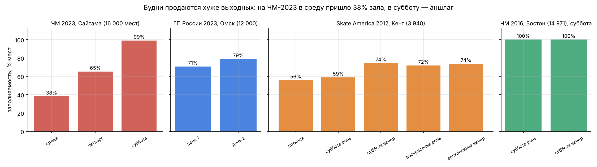
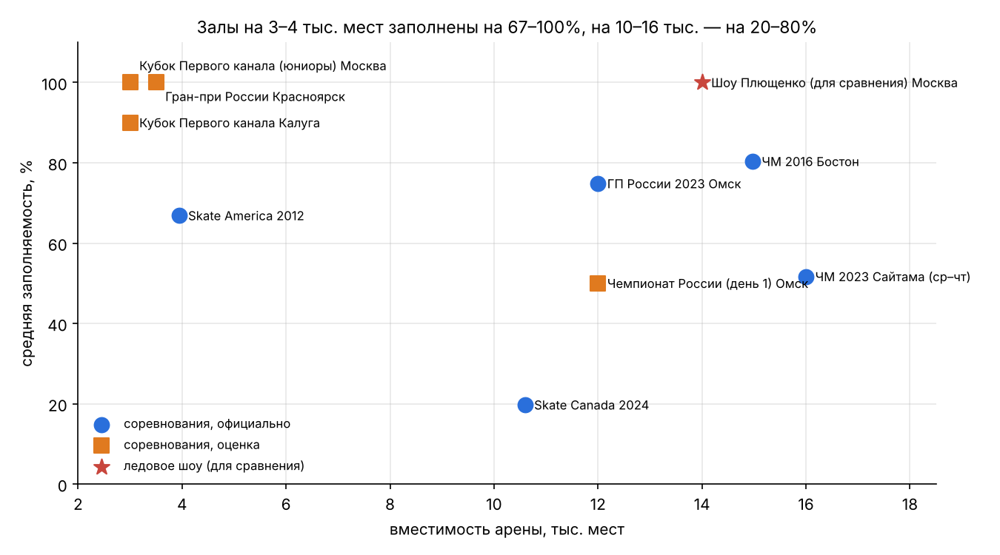
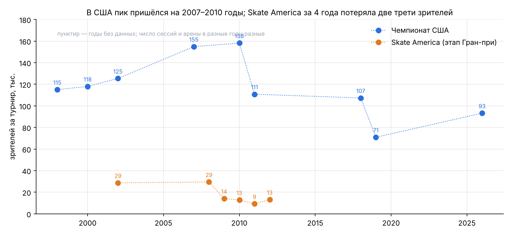
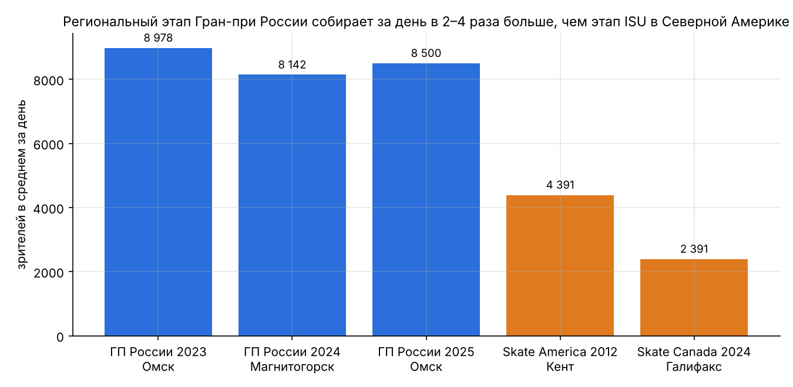

# Кто заполняет трибуны на фигурном катании

Официальной статистики посещаемости турниров по фигурному катанию нет: ISU её не ведёт. Поэтому я собрал датасет сам.
Источники — пресс-релизы федераций, отчёты организаторов и репортажи. В него вошли 24 турнира с 1998 по 2026 год,
13 отдельных сессий и 6 оценок заполняемости российских арен. У каждой цифры в [`data/`](data) есть ссылка на источник
и пометка, что это: официальный подсчёт, проданные билеты или оценка репортёра.

Вопрос, на который я хотел ответить: что продаёт билеты на фигурное катание — сам турнир, день недели, размер зала или звёзды?

## Выводы



**1. Будни продаются хуже выходных, и это главный рычаг.** На чемпионате мира 2023 в Сайтаме в среду пришло 6 110 зрителей
(38% зала на 16 000 мест), в четверг — 10 428 (65%). Субботу продали полностью, кроме самого дорогого тира.
В Бостоне в 2016 году обе субботние сессии собрали больше 15 тысяч при вместимости 14 971.
На Skate America 2012 вечера выходных заполнены на 72–74%, а пятница — на 56%.
Для организатора отсюда простая идея: короткие программы будних дней нужно продавать абонементом вместе с выходными
или дешевле. Иначе в трансляции будут видны пустые трибуны.



**2. Размер зала важнее статуса турнира.** Арены на 3–4 тысячи мест в Красноярске, Калуге и на малой арене ЦСКА
заполнены на 90–100%. Большие залы на 10–16 тысяч заполнены на 20–80%. Хуже всех — Skate Canada 2024 в Галифаксе:
8 363 проданных билета за 4 дня в зале на 10 595 мест, то есть 20%. Исключения — чемпионаты мира в Бостоне и ледовые шоу:
шоу Плющенко в 2022 году собрало полную ВТБ Арену на 14 тысяч в тот же вечер, когда этап Гран-при России шёл на ЦСКА.



**3. В США интерес к живому фигурному катанию снижается давно.** Чемпионат США собрал рекордные 154 893 зрителя в 2007 году
и 158 170 в 2010-м, а в 2019-м — 70 886. Skate America упала с 29 477 зрителей в 2008 году до 9 250 в 2011-м.
Падение не сплошное: в 2026 году чемпионат США собрал 93 231 человека. К тому же турниры проходят в разных городах
и на аренах разного размера, поэтому часть разницы — это площадка, а не спрос.



**4. Внутренние российские турниры после 2022 года собирают больше зрителей за день, чем североамериканские этапы ISU.**
Этапы Гран-при России в Омске и Магнитогорске привлекают 8–9 тысяч зрителей в день. Skate Canada 2024 — около 2,4 тысячи.
Но и здесь работает размер города и зала: в Сочи в 2022 году, по неофициальным данным, в лучший день пришло не больше
1 500 человек, а в первый день чемпионата России 2025 года в Омске была занята примерно половина 12-тысячной арены.

## Ограничения

- Выборка маленькая и неслучайная. Цифры публикуют, когда ими можно похвастаться, поэтому удачных турниров в данных больше.
- Общая посещаемость турниров несравнима напрямую: у турниров разное число сессий и дней. Где число сессий известно,
  я считаю заполняемость как зрители / (сессии × вместимость).
- Российские оценки заполняемости в [`data/russia_reports.csv`](data/russia_reports.csv) — слова репортёров и чиновников.
  На графике они отмечены другим маркером.
- Данные по сессиям ЧМ-2023 есть только за среду и четверг; субботу я отметил как 99%, потому что не продан был только самый дорогой тир.

## Чемпионат России 2027: официальная цена против перепродажи

Продажи на чемпионат России в Челябинске (17–20 декабря 2026, арена «Трактор») открылись 9 ноября на chel.kassir.ru.
Билеты на ключевые программы почти сразу закончились. Дольше всего держался четверг — та же картина с буднями,
что и в исторических данных.

| День | Официальная цена, ₽ | Перепродажа, ₽ |
|---|---|---|
| 17 декабря, четверг | 350–750 | — |
| 18 декабря, пятница | 400–800 | 5 000–10 000 |
| 20 декабря, финальный день | 1 000–2 500 | — |

Официальные цены — по [МГОРСК.ру](https://mgorsk.ru/text/sport/2026/11/09/76753473/), перепродажа —
по [tickets-russia.ru](https://tickets-russia.ru/figure-skating/bilety-chempionat-rossii-po-figurnom-kataniju/57531/)
на 25 ноября 2026. Перепродажа на пятницу в 6–12 раз дороже самого дорогого официального билета. Это признак того, что официальная цена
заметно ниже того, что зрители готовы платить, и разницу забирают перекупщики.

**Сбор продолжается.** [`track-tickets.yml`](.github/workflows/track-tickets.yml) раз в день до начала турнира сохраняет
цены перепродажи по дням в [`data/tickets/`](data/tickets). Это одна загрузка в день с каждой страницы. После турнира
здесь появится кривая: как наценка меняется по мере приближения старта и какие дни дешевеют.

## Структура

```
data/events.csv          турниры: вместимость, дни/сессии, общая посещаемость, тип цифры, источник
data/sessions.csv        посещаемость отдельных сессий
data/russia_reports.csv  оценки заполняемости российских арен
data/tickets/            ежедневные снимки цен перепродажи (собирает GitHub Actions)
scripts/make_figures.py  все графики
```

```bash
pip install pandas matplotlib
python scripts/make_figures.py
```

---

**EN.** There are no official attendance statistics for figure skating, so I built a dataset by hand from federation press
releases, organiser reports and news coverage: 24 events (1998–2026), 13 sessions and 6 arena fill estimates, each with a
source link. Findings: weekday sessions sell far worse than weekends (Worlds 2023: 38% on Wednesday, sold out on Saturday);
small arenas (3–4k seats) fill up while large ones (10–16k) are 20–80% full; US live attendance peaked in 2007–2010; Russian
domestic Grand Prix stages now draw 2–4× more spectators per day than North American ISU events. A daily GitHub Actions job now tracks resale
prices for the 2027 Russian Championships: resale currently runs at 6–12× the top official price.
